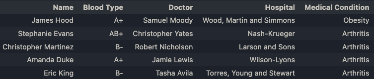

# Tutoriel : Créer un assistant conversationnel

Ce repository construit un agent conversationnel dans le contexte de la santé : un assistant qui permet aux médecin·e·s d'un hôpital de rechercher des informations sur les patient·e·s.

Il sert aussi de tutoriel pour se former à l'IA générative.

Table des matières :

- [Tutoriel : Créer un assistant conversationnel](#tutoriel--créer-un-assistant-conversationnel)
  - [1. Explication du cas d'étude](#1-explication-du-cas-détude)
  - [2. Installation du code](#2-installation-du-code)
    - [2.1. Installation de l'environnement](#21-installation-de-lenvironnement)
    - [2.2. Configuration d'AWS Bedrock](#22-configuration-daws-bedrock)
  - [3. Explication du code](#3-explication-du-code)
    - [3.1. Agent IA et tools](#31-agent-ia-et-tools)
    - [3.2. Liste des tools](#32-liste-des-tools)
      - [3.2.1. Tool : Healthcare Data Search](#321-tool--healthcare-data-search)
    - [3.3. LLM : Claude 3 - Haiku](#33-llm--claude-3---haiku)
    - [3.4. Monitoring du prompt](#34-monitoring-du-prompt)
  - [4. Pour contribuer](#4-pour-contribuer)
    - [4.1. ⚠️ IMPORTANT : Hooks de pré-commit](#41-️-important--hooks-de-pré-commit)
    - [4.2. Pour ajouter des packages](#42-pour-ajouter-des-packages)
    - [4.3. Pour la gestion des branches Git](#43-pour-la-gestion-des-branches-git)

## 1. Explication du cas d'étude

Le cas d'étude est un cas `Santé` pour un hôpital. \
Le souhait de l'hôpital :

- Fournir un agent conversationnel aux médecin·e·s de l'hôpital pour permettre la recherche d'informations sur les patient·e·s.

Le dataset contient des données synthétiques de patient·e·s et de docteur·e·s.

Le dataset peut être retrouvé sur Kaggle : [Healthcare Dataset](https://www.kaggle.com/datasets/prasad22/healthcare-dataset)

Pour plus d'explications sur le fonctionnement du code, voir [section 3](#3-explication-du-code).

## 2. Installation du code

### 2.1. Installation de l'environnement

Le code est en Python et fonctionne avec Poetry pour la gestion des dépendances. \
Un fichier `requirements.txt` est également disponible.

Pour installer Poetry :\
`pip install -U pip setuptools`\
`pip install poetry`

Pour créer votre environnement virtuel Python :\
`python -m venv .venv`

Pour ajouter votre `.venv` à Poetry :\
`poetry env use /full/path/to/.venv/bin/python` \
(Pour trouver le chemin, exécutez `which python` après avoir activé l'environnement)

### 2.2. Configuration d'AWS Bedrock

Copiez le fichier `.env_template` vers `.env` et renseignez `AWS_CREDENTIALS_PROFILE_NAME` avec le nom d'un profil AWS CLI ayant accès à Claude 3 Haiku sur Bedrock (région `us-east-1`).

## 3. Explication du code

Pour lancer la démo en streamlit :\
`python -m streamlit run demo/streamlit_demo.py`

### 3.1. Agent IA et tools

Le cœur du projet se trouve dans `app/src/`. \
Vous y trouverez le code Python pour l'agent conversationnel et celui pour les tools.

Les "tools" font référence aux outils disponibles pour l'agent conversationnel afin d'effectuer des actions.\
Par exemple, sur ChatGPT, on trouve des outils comme Bing pour permettre à l'agent d'effectuer des recherches sur Internet.

L'agent conversationnel fonctionne en suivant la logique [ReAct](https://react-lm.github.io/) pour raisonner (Reasoning) et agir (Acting).

Le code pour l'agent et ses outils est construit en utilisant [LangChain](https://python.langchain.com/docs/get_started/introduction/).

### 3.2. Liste des tools

La liste des outils est :

- Toxicity Police : pour la gestion des questions à caractère toxique (par exemple : sexisme, racisme, demande d'informations compromettantes...)
- Irrelevancy : pour la gestion des questions sans lien avec le cas d'étude (par exemple : demander la météo)
- Healthcare Data Search : pour la gestion des questions sur les informations des patient·e·s (uniquement les informations autorisées, sinon --> toxicity police)
- Historique de la conversation : pour la gestion des questions nécessitant d'avoir accès à l'historique de la conversation (par exemple : qui était le premier patient avec le groupe sanguin B+?)

#### 3.2.1. Tool : Healthcare Data Search

L'outil "Healthcare Data Search" fait appel à un deuxième LLM pour générer une réponse formatée.

Ce tool a son propre prompt dédié qui lui permet de convertir la requête de l'utilisateur en un dictionnaire Python facilement utilisable pour requêter un dataset. \
On peut assimiler l'utilisation de ce tool à une tâche de [Named Entity Recognition (NER)](https://en.wikipedia.org/wiki/Named-entity_recognition).

Par exemple :

- Requête : "Quel est le groupe sanguin de Christina Hernandez ?"
- Réponse de l'agent : `{'patient_name': 'Christina Hernandez', 'patient_blood_type': 'True'}`
- Explication : La requête a été transformée en un dictionnaire facilement utilisable. Maintenant, nous pouvons aller chercher dans notre jeu de données le patient `patient_name` et obtenir/retourner la valeur du `patient_blood_type` pour formuler la réponse.

### 3.3. LLM : Claude 3 - Haiku

Dans ce tutoriel, [Claude 3 - Haiku](https://www.anthropic.com/news/claude-3-family) est utilisé pour les raisons suivantes :

- Rapide et peu coûteux
- AWS Bedrock : pour montrer comment utiliser simplement Bedrock
- [Prompt engineering](https://docs.anthropic.com/claude/docs/prompt-engineering) : pour montrer les techniques spécifiques aux modèles de la famille Claude (notamment l'utilisation des balises XML)

### 3.4. Monitoring du prompt

Il est important de monitorer le prompt pour deux raisons :

- Le changement et/ou l'évolution du modèle (par exemple : une mise à jour de GPT-3.5 qui viendrait rompre le fonctionnement de notre agent sans que nous modifions le prompt)
- L'ajout de features ou de fixs en modifiant le prompt (pour s'assurer que le nouveau prompt ne va pas casser le fonctionnement de l'application)

Heureusement, il est assez simple de monitorer le prompt avec des tests, et il est même possible d'écrire son prompt en faisant du [Test Driven Development (TDD)](https://en.wikipedia.org/wiki/Test-driven_development).

Pour ce tutoriel, trois ensembles de tests ont été mis en place dans le dossier `/tests/` :

- `test_irrelevancy` : pour tester la bonne activation du tool sur les questions hors-sujet
- `test_toxicity` : pour tester la bonne activation du tool sur la toxicité
- `test_llm_ner` : pour tester la bonne conversion d'une requête en un dictionnaire par le deuxième prompt

## 4. Pour contribuer

### 4.1. ⚠️ IMPORTANT : Hooks de pré-commit

Il y a des hooks de pré-commit, merci de les utiliser :\
`pre-commit install`

Ces hooks permettent de maintenir un environnement de développement propre et cohérent entre les développeurs.

Les hooks se basent sur [Ruff](https://docs.astral.sh/ruff/tutorial/) pour garantir la conformité aux normes de codage PEP8, faciliter la détection d'erreurs et bien plus.

### 4.2. Pour ajouter des packages

Pour ajouter un package, il faut passer par Poetry :\
`poetry add <nom_du_package>`

### 4.3. Pour la gestion des branches Git

Essayons de suivre quelques principes du [trunk based development](https://paulhammant.com/2013/04/05/what-is-trunk-based-development/) :

- Une branche `main` protégée
- Chaque nouvelle branche part de `main` pour y ajouter une feature, un fix, etc., puis sera mergée sur `main` avec une Merge Request
- Si une autre branche `feature` est mergée sur `main` avant la vôtre, faites un `git rebase main` depuis votre branche `feature` pour être à jour

_À votre tour !_
